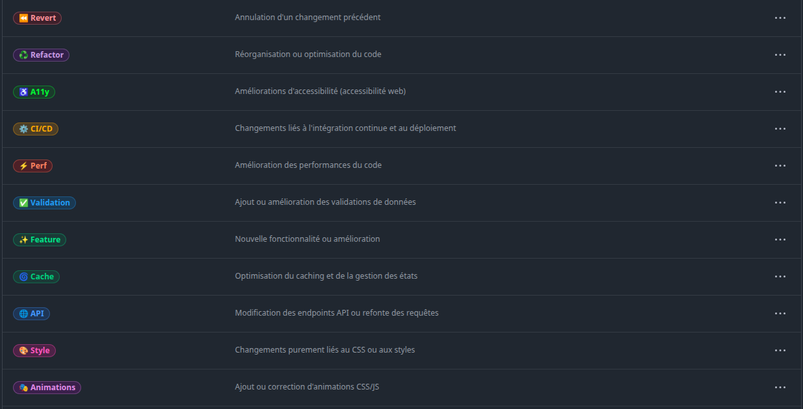
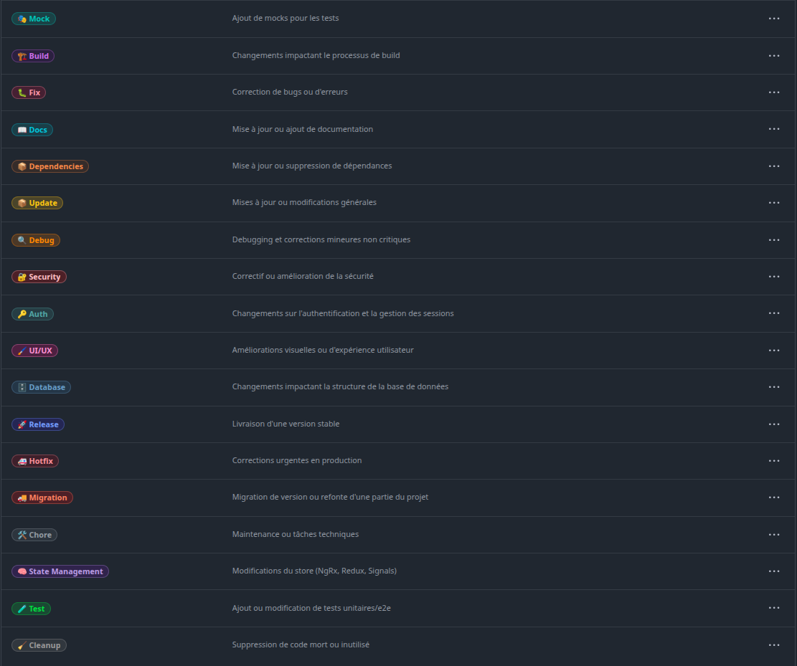

<div align="center">

# 🏷️ LabelSync Pro

**One label set. Every repository. Always in sync.**

A GitHub Action and CLI that keeps the same labels on all your repositories —
with minimal diffs, renames that keep your issues labelled, and a dry run before anything changes.

[](https://github.com/j-ned/labelsync-pro/actions/workflows/ci.yml)
[](LICENSE)


[Quick start](#-quick-start) · [All your repos](#-sync-every-repository-you-own) · [CLI](#-try-it-from-your-terminal) · [Config](#-configuration) · [Inputs](#%EF%B8%8F-inputs--outputs) · [🇫🇷 Français](README.fr.md)



</div>

## Why

Every new repository starts with GitHub's nine default labels. After a few projects you end up with
`bug` here, `🐛 Fix` there, `type: bug` somewhere else — and filters, boards and release notes that
work in one repo and not the next.

LabelSync Pro treats your labels as code: describe them once in a JSON file, and it brings
**every repository** in line — the current one, all the ones you own, or a whole organization.

## ✨ Highlights

- **Minimal diffs** — compares first, then only calls the API for what actually changed. An up-to-date repo costs one request.
- **Renames that keep history** — list a label's old names in `aliases`: `bug` becomes `🐛 Fix` *in place*, so every issue and PR keeps it. No delete-and-recreate.
- **Safe by default** — labels that aren't in your config are kept unless you turn on `prune`. `dry-run` shows the exact plan first.
- **One repo or hundreds** — `current`, `all`, or `latest` repository of a user or organization, processed in parallel with automatic retries on rate limits.
- **Opt-out per repo** — add the `no-labelsync` topic, or list it in `exclude`.
- **Readable reports** — a job summary with a per-repository table and a diff of every change.
- **Also a CLI** — preview or apply the same config from your terminal with your `gh` login.
- **Zero dependencies, no build step** — plain Node.js 24, small enough to read in ten minutes.

## 🚀 Quick start

Sync the labels of the repository the workflow runs in.

**1. Describe your labels** in `.github/labels.json`:

```json
{
  "$schema": "https://raw.githubusercontent.com/j-ned/labelsync-pro/master/schema/labels.schema.json",
  "labels": [
    { "name": "🐛 Fix", "color": "dc3545", "description": "Something isn't working", "aliases": ["bug"] },
    { "name": "✨ Feature", "color": "198754", "description": "New feature or request", "aliases": ["enhancement"] },
    { "name": "📖 Docs", "color": "17a2b8", "description": "Documentation", "aliases": ["documentation"] }
  ]
}
```

The `$schema` line gives you autocompletion and validation in VS Code, WebStorm and friends.

**2. Add a workflow**, e.g. `.github/workflows/labels.yml`:

```yaml
name: Sync labels
on:
  push:
    branches: [main]
    paths: [.github/labels.json]
  workflow_dispatch:

permissions:
  issues: write

jobs:
  labels:
    runs-on: ubuntu-latest
    steps:
      - uses: actions/checkout@v5
      - uses: j-ned/labelsync-pro@v2
```

That's it: the default `GITHUB_TOKEN` is enough for the current repository.

## 🌍 Sync every repository you own

Keep one "control" repository with your config and a schedule. It needs a token that can reach
your other repositories:

1. Create a [fine-grained personal access token](https://github.com/settings/personal-access-tokens/new) with
   **Repository access: All repositories** and permissions **Metadata: Read** + **Issues: Read and write**.
2. Save it as a repository secret, e.g. `LABELSYNC_TOKEN`.
3. Add the workflow:

```yaml
name: Sync labels everywhere
on:
  schedule:
    - cron: "0 6 * * *"          # every morning
  workflow_dispatch:

permissions:
  contents: read

jobs:
  labels:
    runs-on: ubuntu-latest
    steps:
      - uses: actions/checkout@v5
      - uses: j-ned/labelsync-pro@v2
        with:
          token: ${{ secrets.LABELSYNC_TOKEN }}
          scope: all                # or: latest — only the newest repository
          # owner: my-org           # an organization instead of your own account
          exclude: |
            me/some-fork-i-care-about
```

Archived repositories, forks (unless `include-forks: true`), repositories you can't write to,
and repositories tagged with the `no-labelsync` topic are skipped automatically.

> [!TIP]
> Run it once with `dry-run: true` and read the job summary before letting it write anything.

## 💻 Try it from your terminal

No install needed — Node.js 22+ and either `gh auth login` or a `GITHUB_TOKEN`:

```bash
# Preview: nothing is written without --apply
npx github:j-ned/labelsync-pro --repo me/my-app \
  --config https://raw.githubusercontent.com/j-ned/labelsync-pro/master/presets/emoji-en.json

# Apply to every repository you own
npx github:j-ned/labelsync-pro --scope all --config .github/labels.json --apply

# Check a config file
npx github:j-ned/labelsync-pro validate .github/labels.json
```

```text
🏷️ me/my-app
[dry-run] ~ rename  "bug" → "🐛 Fix", color #dc3545, description
[dry-run] ~ rename  "enhancement" → "✨ Feature", color #198754, description
[dry-run] + create  "🚑 Hotfix" #b22222
...
1 repository, 29 change(s) planned, 0 failed
Dry run: nothing was written. Re-run with --apply to apply.
```

Run `npx github:j-ned/labelsync-pro --help` for every option.

## 🧩 Configuration

```jsonc
{
  "$schema": "https://raw.githubusercontent.com/j-ned/labelsync-pro/master/schema/labels.schema.json",
  "labels": [
    {
      "name": "🐛 Fix",              // required, ≤ 50 characters, matched case-insensitively
      "color": "dc3545",             // required, hex with or without "#"
      "description": "Bug fix",      // optional, ≤ 100 characters
      "aliases": ["bug", "type: bug"] // optional, previous names to rename in place
    }
  ],
  "exclude": ["me/legacy-repo"]       // optional, repositories never touched
}
```

- A bare array of labels (the v1 format) is still accepted.
- The config is validated before any API call, and every problem is reported at once
  (duplicate names, colors, lengths, collisions between names and aliases…).
- `config` can also be an **https URL**, so several control repositories can share one preset.

### Presets

Two ready-to-use sets of 29 emoji labels (feature, fix, hotfix, refactor, CI/CD, a11y, perf, security, tests…),
with aliases that convert GitHub's default labels:

| Preset | Use it with |
|---|---|
| [`presets/emoji-en.json`](presets/emoji-en.json) | `config: https://raw.githubusercontent.com/j-ned/labelsync-pro/master/presets/emoji-en.json` |
| [`presets/emoji-fr.json`](presets/emoji-fr.json) | `config: https://raw.githubusercontent.com/j-ned/labelsync-pro/master/presets/emoji-fr.json` |



## ⚙️ Inputs & outputs

| Input | Default | Description |
|---|---|---|
| `token` | `${{ github.token }}` | Token used for the API. Use a PAT for `scope: all` / `latest`. |
| `config` | `.github/labels.json` | Path in the workspace, or https URL. |
| `scope` | `current` | `current`, `all` (every non-archived repository of `owner`) or `latest` (the newest one). |
| `repositories` | | Explicit `owner/name` list (newline or comma separated). Overrides `scope`. |
| `owner` | token's user | User or organization listed by `all` / `latest`. |
| `exclude` | | Repositories never touched. Adds to the config's `exclude`. |
| `skip-topic` | `no-labelsync` | Repositories with this topic are skipped. Empty to disable. |
| `include-forks` | `false` | Also sync forks. |
| `prune` | `false` | Delete labels that aren't in the config. |
| `dry-run` | `false` | Only report what would change. |
| `concurrency` | `4` | Repositories processed in parallel. |

| Output | Description |
|---|---|
| `repositories` | Number of repositories processed. |
| `changes` | Label operations applied (or planned in a dry run). |
| `failed` | Repositories that failed. The step fails if this isn't `0`, after every repository has been tried. |
| `report` | Full JSON report, for your own follow-up steps. |

## 🛡️ How it stays safe

1. **Validate** the config — nothing is sent if it's invalid.
2. **Read** the repository's labels, then **plan**: match each label by name (case-insensitive), then by alias.
3. **Apply** only the difference — renames and updates first, then creations, then deletions (only with `prune`).

> [!WARNING]
> Deleting a label removes it from every issue and pull request that had it. That's why `prune` is off by default.
> Before enabling it, add the labels your tools create to the config — Dependabot's `dependencies`, for instance, or it will come back on its next run.

A failure on one repository (missing permission, archived meanwhile…) is reported and doesn't stop the others.

## ⬆️ Upgrading from v1

v1 was a reusable workflow (`.github/workflows/manage-labels.yml`). v2 is a regular action:

| v1 | v2 |
|---|---|
| `uses: j-ned/labelsync-pro/.github/workflows/manage-labels.yml@master` | `uses: j-ned/labelsync-pro@v2` in a step, after `actions/checkout` |
| `mode: all` / `latest` | `scope: all` / `latest` |
| `dry_run` | `dry-run` |
| `labels_path` | `config` |
| `exclude_path` + `exclude.json` | `exclude` input, or `"exclude"` in the config |
| Always deleted unknown labels | `prune: true` to keep that behaviour |
| Forks were synced | `include-forks: true` to keep that behaviour |

Your existing `labels.json` array works as is.

## 🤝 Contributing

Issues and pull requests are welcome. The code is plain ES modules with JSDoc types, no dependencies:

```bash
npm test            # node --test
npm run validate    # check the presets
```

## 📄 License

[MIT](LICENSE) © j-ned
